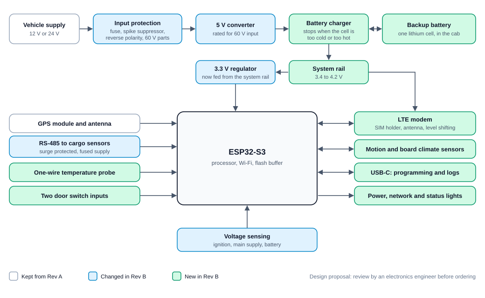

# Maatora tracker board: Rev B design

A proposed second revision of the vehicle unit, based on a review of the Rev A schematic (`Schematic.pdf`, one page: ESP32-S3, NEO-7M GPS, RS-485, 12 V input).

**Status: a design proposal, not a finished schematic.** It was written from a drawing and from datasheets, without a board to measure. An electronics engineer must review it, and every part value marked *verify* must be checked against the manufacturer's datasheet, before anything is ordered. Figures quoted from datasheets list their source at the end.

