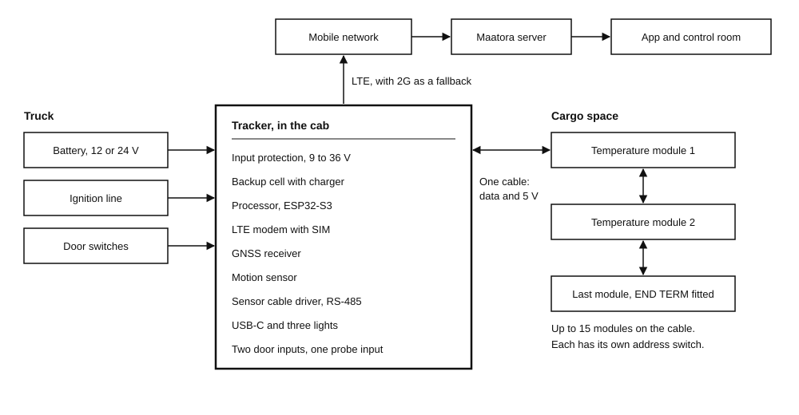

# Maatora hardware

Two boards make up the hardware side of Maatora.

- **The tracker** sits in the cab. It takes power from the truck, keeps a backup cell charged, knows where it is, reads the door switches, powers and reads the temperature modules, and reports to the Maatora server over the mobile network.
- **The temperature module** sits in the cargo space. It measures air temperature and humidity and answers the tracker over one cable, which also brings its power. Several modules chain along the same cable.



## Status

This is a schematic-level design for review. Read this list before relying on anything in the folder.

- **Done.** Every part, pin and connection of both boards, with values. Drawings, parts lists, netlists and pin maps, all produced from one description. Automatic wiring checks. Pin numbers and limits of the main parts compared with their datasheets (listed below).
- **Not done.** No printed-circuit layout. No board has been built or measured. No firmware has been written.
- **Never opened in KiCad.** The `.kicad_sch` files are written by a script, and KiCad is not installed on the PC they were made on. They pass the script's own checks, but the first real test is opening them. If KiCad refuses one, the PDFs and the CSV files carry the same design.
- **Values come from datasheet formulas**, not from simulation or measurement. Prices and battery runtimes are estimates.
- An electronics engineer should review it before boards are ordered. [BUILD-GUIDE.md](BUILD-GUIDE.md) says what to check, in what order.

## Files

| File | What it is |
| --- | --- |
| `tracker/maatora-tracker-schematic.pdf` | The whole tracker on one large sheet |
| `tracker/maatora-tracker-sections.pdf` | The same drawing, one section per A3 page: the one to print |
| `tracker/maatora-tracker.kicad_pro`, `.kicad_sch` | KiCad project and schematic |
| `tracker/maatora.kicad_sym` | The symbols the schematic uses |
| `tracker/maatora-tracker-parts.csv` | Parts list with part numbers, footprints and estimated prices |
| `tracker/maatora-tracker-netlist.csv` | Every net and the pins on it |
| `tracker/pin-map.md` | What each processor pin does |
| `temperature-module/` | The same set of files for the module |
| `tools/build.py` | The description of both boards. Edit this, then rebuild |
| `tools/kit.py` | Turns the description into the files above and checks it |
| [USER-GUIDE.md](USER-GUIDE.md) | Fitting it in a truck and using it |
| [BUILD-GUIDE.md](BUILD-GUIDE.md) | From these files to working boards: KiCad, layout rules, first power-up |
| [SENSOR-BUS.md](SENSOR-BUS.md) | The cable between the tracker and the modules, and the messages on it |
| [FIRMWARE.md](FIRMWARE.md) | What the software on each board has to do |
| [PROTOCOL.md](PROTOCOL.md) | How the tracker talks to the server |

## The tracker, section by section

The numbers match the sections of the drawing.

**1. Vehicle input and protection.** A locking four-pin connector brings supply, ground and the ignition line. In order: a resettable fuse, a surge diode that stays off up to 33 V and clamps spikes above that, a diode that blocks a reversed supply, and a 100 µF capacitor. Every part here is rated for 60 V or more, so the same board fits 12 V and 24 V trucks. Two dividers let the processor measure the supply and the ignition line (pin voltage × 22.28).

**2. Vehicle supply down to 5 V.** An LM2596HV, chosen for its 60 V input rating. Its output feeds the charger and nothing else, which is what lets the rest of the board ignore a power cut.

**3. Charger and backup battery.** A BQ24074 charges one lithium cell at 0.5 A and produces the system rail, `VSYS`. With vehicle power present `VSYS` is 4.4 V. Without it the charger passes the cell through, with no gap. It refuses to charge when the cell is below about 0 °C or above about 50 °C, which it reads from the temperature sensor inside the battery pack. A green light shows vehicle power. The processor measures the cell (pin voltage × 2) and sees whether it is charging.

**4. Logic supply, 3.3 V.** A small step-down converter from `VSYS` feeds the processor, the on-board sensors and the cable driver. They keep running on the battery.

**5. Modem supply, 3.8 V.** The modem accepts 3.4 to 4.2 V. `VSYS` is 4.4 V on vehicle power, which is too high, and falls towards 3.3 V on a tired cell, which is too low. A TPS63020 converter holds 3.8 V across that whole range. A 1000 µF capacitor beside the modem covers its transmit bursts. One processor pin removes the supply completely, which is the dependable way to restart a modem that has stopped answering.

**6. Switched 5 V for the GNSS module and the sensor cable.** An MT3608 steps `VSYS` up to 5 V, followed by a switch. Because this rail starts from `VSYS` and not from the truck, position and cargo readings carry on when the truck supply is cut. One processor pin turns the rail off to save the battery or to restart a stuck sensor. The cable has its own 0.5 A resettable fuse.

**7. LTE modem and SIM.** A SIMCom A7670E: LTE Cat 1 with 2G as a fallback. Its logic runs at 1.8 V, so a translator sits between it and the 3.3 V processor. The translator is powered from the modem's own 1.8 V output, so it lets go of the lines when the modem is off. There is a nano SIM holder with protection, an antenna connector with space for a matching network, and a blue light driven by the modem. One line lets the processor put the modem to sleep and wake it, which is what makes days on the battery possible.

**8. Processor.** An ESP32-S3-WROOM-1 module. [tracker/pin-map.md](tracker/pin-map.md) lists every pin. The doors and the motion sensor are on pins that can wake the processor from sleep. Reset and boot buttons, and an amber status light.

**9. USB-C and programming header.** USB-C goes to the processor's own USB for programming and logs. It carries data only and does not power the board. The six-pin serial header from Rev A is kept, with its automatic programming circuit.

**10. GNSS module.** The NEO-7M module from Rev A on a five-pin header, on the switched 5 V rail. It needs an external active antenna with a view of the sky.

**11. RS-485 sensor bus.** The cable driver, with surge protection on the data lines and on the cable's 5 V. The tracker is one end of the cable, so it carries the 120 Ω terminator and the two resistors that hold the line in a defined state while nobody talks.

**12. Door inputs.** Two inputs for magnetic switches that close to ground when a door is shut. A wire shorted to 24 V does no damage.

**13. Probe input and on-board sensors.** A header for one sealed DS18B20 probe, for a truck that needs a single reading and no modules. A motion sensor that notices the unit being moved or struck while parked. A temperature and humidity sensor for the air inside the enclosure: it warns of condensation or an overheating cab, and is not a cargo reading.

## The temperature module, section by section

**1. Bus connectors and supply.** Two sockets wired straight through: cable in, cable out. The 5 V from the cable passes a resettable fuse and a diode against a reversed supply, then a regulator makes 3.3 V. The regulator tolerates 13.2 V, so a wrong supply on the cable trips the fuse instead of killing the board. The module measures the cable voltage (pin voltage × 4.03), so a weak supply at the far end of a long cable shows up in the readings.

**2. RS-485 transceiver.** One processor pin switches between listening and answering. It listens by default. The END TERM jumper is fitted on the last module of the cable only.

**3. Microcontroller.** An ATmega328P running at 3.3 V from an 8 MHz crystal. The chip's internal oscillator would save two parts, but it drifts too far between a freezer and a hot loading dock for reliable serial timing. A four-way switch sets the module's address, 1 to 15. A green light blinks each time the module answers.

**4. Sensors.** A Sensirion SHT45 at the edge of the board, behind a slot cut in the board so the chips' warmth does not reach it. A header takes an optional DS18B20 probe on a lead, for the middle of the load.

## Power: what runs from what

```
Truck, 9 to 36 V
  fuse, surge diode, reverse diode            VIN_PROT
    LM2596HV step-down                        +5V       feeds the charger only
      BQ24074 charger and power path          VSYS      4.4 V on truck power, cell voltage without it
        backup cell, one lithium cell         VBAT
        TLV62569 step-down                    +3V3      processor, sensors, cable driver
        TPS63020 buck-boost, switchable       V_MODEM   3.8 V for the modem
        MT3608 step-up and switch, switchable 5V_SW     GNSS module and the sensor cable
```

When the truck supply is cut, `+5V` disappears and the charger passes the cell to `VSYS`. Everything below `VSYS` keeps running: processor, modem, GNSS and the temperature modules. The processor sees the supply reading fall and reports it. The server raises a power alert when the reported supply is below 6 V.

**How long the battery lasts has not been measured.** A 2600 mAh cell holds about 9 Wh. With everything left running (processor awake, modem attached, GNSS on, two modules) expect a draw of roughly 0.5 to 0.8 W, so about half a day. If the firmware switches the GNSS module and the sensor cable on only for each reading and lets the modem sleep between uploads, several days is realistic. The modem guide used for this design leaves the modem's standby current blank, so measure the real figure on the first board before promising one to a customer.

## What it costs

Estimates for small quantities, in US dollars. The parts lists carry the price of every line.

| | Parts on the board | Whole unit |
| --- | --- | --- |
| Tracker | about 32 | about 55, with GNSS module, antennas, cell, board, enclosure and harness |
| Temperature module | about 10 | about 13, with board, enclosure and one cable |

The modem (about 11) and the SHT45 sensor (about 4.50) are the largest single lines.

## What was compared with datasheets

Pin numbers and the limits that matter were read from the manufacturer's document for these parts.

| Part | What was compared | Document |
| --- | --- | --- |
| A7670E modem | All 88 pads, supply range and peak current, power-key and reset timing, 1.8 V logic, light patterns | SIMCom A7670 Series Hardware Design V1.00 |
| BQ24074 charger | Pins, input range, 4.4 V output, current-setting formulas, temperature input | [TI datasheet](https://www.ti.com/lit/gpn/bq24074) |
| TPS63020 | Pins, 0.5 V feedback and divider, inductor, capacitors, the `VINA` pin | [TI datasheet](https://www.ti.com/lit/gpn/tps63020) |
| TLV62569 | Pins, 0.6 V feedback, 2.5 to 5.5 V input, 2 A | [TI datasheet](https://www.ti.com/lit/ds/symlink/tlv62569.pdf) |
| LM2596HV | Pins, 60 V input rating | Datasheet |
| MT3608 | Pins, 0.6 V feedback, input range, inductor range, enable level | Datasheet |
| TXS0104E translator | Pins, supply rule, enable pin | TI datasheet |
| LIS3DH motion sensor | All 16 pins, address select, unused pins | ST datasheet |
| SHT4x sensors | Pins, supply range, address, measurement command | Sensirion datasheet |
| MCP1702 regulator | Pins, 13.2 V input, dropout | [Microchip DS22008E](https://ww1.microchip.com/downloads/en/DeviceDoc/22008E.pdf) |
| ATmega328P | All 32 pins, 8 MHz allowed from 2.7 V, fuse tables | [Atmel 7810 datasheet](https://ww1.microchip.com/downloads/en/DeviceDoc/Atmel-7810-Automotive-Microcontrollers-ATmega328P_Datasheet.pdf) |
| SMF05C | Pin assignment | [onsemi datasheet](https://www.onsemi.com/pdf/datasheet/smf05c-d.pdf) |

**Not compared.** These use the pin numbers such parts normally have, written from memory. Check each against the datasheet of the exact part you buy, before layout:

- **ESP32-S3-WROOM-1.** Its datasheet could not be downloaded when the design was made. It has the most connections of any part here, so check it first, against [tracker/pin-map.md](tracker/pin-map.md).
- USBLC6-2SC6, SM712, SP3485, BAT54S, MMBT3904, SS8050, AO3401A, AO3400A, and the direction of every diode.
- The connectors: USB-C, nano SIM holder, RJ45, Micro-Fit, JST. A holder or socket from another maker can number its pins differently.
- The voltage rating of both resettable fuses. The input fuse must be a 60 V or 72 V type. The common MF-R160 is a 30 V part and is not suitable.
- The SY8089, listed as a cheaper stand-in for the TLV62569.

## What changed since Rev A

| Rev A | Problem | Now |
| --- | --- | --- |
| 18 V surge diode, 16 V converter, 30 V transistor | Works on 12 V only. A 24 V truck would trip the fuse or destroy the converter | Input rated for 9 to 36 V, parts rated 60 V |
| No mobile modem on the board | The board cannot report by itself | LTE modem with SIM holder and antenna connector |
| No backup battery | Cutting the supply silences the unit, which is what a dishonest driver would do | A lithium cell with a temperature-supervised charger. Processor, modem, GNSS and cargo sensors all keep running |
| No door input | Door openings are the main accountability signal | Two protected door inputs that can wake the processor |
| RS-485 lines leave the board bare | Static and surges from a long cable into the cargo area | Surge protection, a fused cable supply, a defined idle state |
| Processor cannot tell truck supply from battery | Firmware cannot report a power cut or the battery level | Voltage measurement for the supply, the ignition line and the cell |
| Serial header only | Needs an adapter to program or read logs | USB-C on the processor's own USB, header kept |
| Nothing shows the unit's state | An installer cannot tell whether it works | Power, vehicle supply, network and status lights |
| No motion sensing | The unit cannot sleep and still notice being moved | Motion sensor on a wake pin |

Kept from Rev A: the processor, the GNSS module and its pins, the RS-485 transceiver, the sensor cable pinout, ignition sensing, the switchable 5 V rail and the automatic programming circuit.

The module here is a proposed next revision of the COLDCHAIN RS-485 board. It was drawn from a photo of that board's layout, not from its schematic, so its pin choices are new. It keeps the two sockets, the END TERM jumper, the 32-pin microcontroller, the crystal and the programming header. It adds an address switch, a low surface-mount crystal, protection on the cable, and a sensor placed on the board edge.

## Decisions that are yours

1. **The sensor cable pinout.** This design keeps the Rev A pinout so new boards plug into the ones you already have. That pinout puts 5 V and ground on the same pair of the cable. If someone plugs the sensor cable into a computer or a network switch, 5 V lands across that socket's transformer. The 0.5 A fuse on the tracker limits it, but it can still damage the other device. A second pinout that avoids this is built in: set `CABLE = 'network-safe'` at the top of `tools/build.py` and rebuild. It does not match boards built with the Rev A pinout, so choose before more modules are made. [SENSOR-BUS.md](SENSOR-BUS.md) shows both.
2. **12 V trucks only, or 24 V too?** The board covers both. On a 24 V truck without central surge suppression, a load dump can exceed what the 1500 W surge diode survives. Fitting a load-dump rated diode (SM8S33A class, a larger package) settles it. This needs an engineer's judgement and a test, not an opinion.
3. **A lithium cell in a hot cab.** The charger stops charging above about 50 °C, which is right. A cab parked in the sun goes well past that, and heat shortens the life of any lithium cell. Mount the unit low and out of the sun, and plan to replace cells.
4. **Which cargo sensor.** The SHT45 is typically accurate to ±0.1 °C. For pharmaceutical customers, the SHT43 from the same family is delivered with an individual ISO 17025 calibration certificate. Your own board has a plug-in sensor on A1 that this design does not know.
5. **SIM provider and bands.** Check the exact A7670 variant against the bands your provider uses in Egypt before ordering modems.
6. **Connectors in the cargo space.** RJ45 and network cable are cheap and sold everywhere, which suits a pilot. They are not sealed. For series production in freezers, a sealed industrial connector (M12, five pins) carries the same signals.

## Rebuilding the files

```
python hardware/tools/build.py --pdf
```

It needs Python 3, and Chrome for the PDFs. It rewrites everything in `tracker/` and `temperature-module/` and ends with the result of its checks:

- every pin of every part is either on a net or marked as unconnected on purpose;
- no pin number is used that the part does not have, and no reference is used twice;
- every net reaches at least two pins;
- the finished drawing is read back from its coordinates alone, and the nets found that way must equal the description.

To change the design, edit `tools/build.py`. Each part is one line: its value, then the net on each pin. Do not edit the generated files by hand, because the next build overwrites them.
